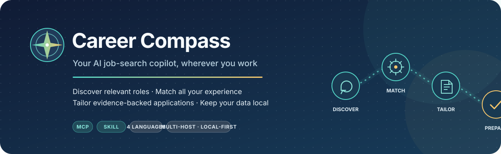
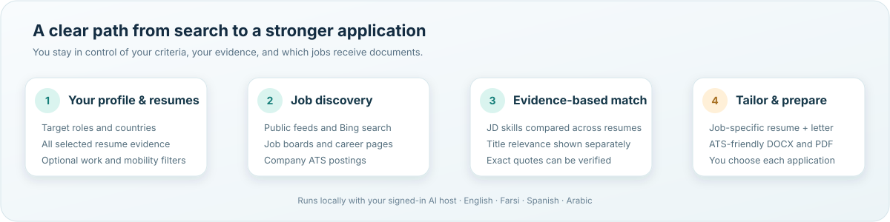

<div align="center">



### A multilingual job-search copilot for the AI assistant you already use

**Discover more relevant roles. Match them against all your experience. Prepare a focused, evidence-backed application for every job you choose.**

[](https://www.python.org/)
[](https://modelcontextprotocol.io/)
[](#multilingual-by-design)
[](#works-with-your-signed-in-ai)
[](LICENSE)

[Get started](#get-started) · [How it works](#how-it-works) · [Sources](#job-discovery) · [Privacy](#privacy-first-by-design)

</div>

Career Compass is a **local-first MCP server and portable Agent Skill** for people managing a serious job search across multiple roles, resumes, countries, and languages. It connects job discovery and application preparation to the signed-in AI host you already have—without asking you to configure a separate model API key.

> You choose the roles, countries, and opportunities. Career Compass helps your assistant search broadly, explain the fit, and create tailored materials from your own evidence.

## How it works

<div align="center">

</div>

| Stage | What Career Compass does |
| --- | --- |
| **Discover** | Searches public job feeds, Bing job results, targeted job-board and company-career queries, and public ATS boards. |
| **Match** | Compares job-description skills with evidence pooled across every resume you import. It reports title relevance separately. |
| **Tailor** | Gives your signed-in host the selected job description and relevant, source-labeled evidence to draft a role-specific resume and cover letter. |
| **Prepare** | Checks drafts, exports DOCX/PDF, preserves source links, and tracks the jobs you are considering. |

## Why Career Compass

### Search beyond one job board

Use built-in public job feeds and Bing's public search feed, then expand discovery with Google or Bing web search in your signed-in host. Paginated queries target job boards, regional sites, and employer career pages. When a public careers page reveals an ATS board, Career Compass can query supported Greenhouse, Lever, Ashby, and SmartRecruiters boards directly.

### Match skills across your full experience

Import multiple resumes and assess the job's identifiable skills against the combined evidence. A job title does not erase relevant skills from another part of your background: **skill coverage and title relevance remain separate**. The connected AI host can make a semantic assessment, while Career Compass checks cited quotes against the underlying resume evidence.

### Tailor each application to the selected job

For a job you select, the Skill guides your host to prioritize that job description and the strongest relevant evidence across your resumes. It produces a plain-text, ATS-readable resume and a distinct cover letter written for the role and employer—not a copy of the resume. Drafts are checked for document structure, evidence provenance, and unsupported numeric claims before export.

The cover-letter workflow targets **220–320 words** and asks for a specific opening, a concise evidence-backed example, a reasoned connection to the employer's stated needs, and a natural close. These checks improve consistency; they do not guarantee an employer response or a score from any third-party ATS.

### Keep the search aligned to your criteria

- Set the target job titles and countries in your local profile.
- Optionally select remote, hybrid, in-person, or other work arrangements.
- Optionally select relocation support or visa sponsorship.
- Selected arrangement and mobility options are acceptable alternatives: a listing that satisfies any selected option can qualify. Empty lists mean **search across all options**.
- Country/work authorization remains unknown unless the listing provides evidence. The tool does not treat “remote” as automatic work eligibility.

### Prepare a requested batch

For a batch you explicitly request, the Skill can prepare up to **five distinct jobs** at a time. If your host exposes browser controls, it can help fill the corresponding forms with your profile and job-specific documents. It does not guess unknown answers, bypass CAPTCHA or two-factor authentication, or claim an application was submitted without a visible confirmation. Without browser controls, it returns the prepared documents and listing links.

## Job discovery

Career Compass combines several discovery paths. Availability and freshness depend on the public source and its rate limits.

| Discovery path | Included sources | How it works |
| --- | --- | --- |
| Public job feeds | Remote OK, Remotive, Arbeitnow, Jobicy, Himalayas, We Work Remotely | Fetches public listings and normalizes them into one searchable collection. Some feeds focus on remote roles. |
| Search feed | Bing public search RSS | Searches job and career-page results from configured criteria. |
| Host web search | Google or Bing when exposed by the signed-in AI host | Generates paginated searches for 26 job boards, regional sites, and company-career pages; the host runs the search and can send public results for import. |
| Company ATS boards | Greenhouse, Lever, Ashby, SmartRecruiters | Queries public board APIs after board identifiers are found. |
| Candidate evidence pages | Candidate-supplied portfolio, GitHub, and career URLs | Reads public pages and relevant same-site links for matching context. Page claims remain unverified until approved. |

Search-query coverage includes LinkedIn job pages, Indeed, Glassdoor, Wellfound, Y Combinator Jobs, EURES, Welcome to the Jungle, Working Nomads, Jobgether, Himalayas, Arbeitnow, Jobicy, Landing.jobs, Relocate.me, No Fluff Jobs, StepStone, Kariyer, Techcareer, InfoJobs, Tecnoempleo, Ergodotisi, Work in Finland, Work in Denmark, and employer career pages. **LinkedIn is not scraped.** Google/Bing web-search queries require native web search in the connected host; the built-in Bing RSS search is a separate source.

Career Compass reports source errors instead of implying an unavailable source was searched. Results retain their reported source and original listing URL; a search-result or careers page is labeled as such when it is not a direct application form.

## Works with your signed-in AI

The MCP server provides local data, search, matching, validation, and export tools. **It does not call an OpenAI, Anthropic, Google, or Qwen model API.** Codex, Claude Code, Gemini CLI, or Qwen Code uses its existing signed-in model for semantic job analysis and writing. No separate LLM API key is needed.

The included `career-compass` Skill explains how the host should use the MCP tools, search with native web search when available, preserve evidence citations, and draft in the selected language. Host commands and configuration formats can change; follow the current documentation for your installed host if a CLI command differs.

## Multilingual by design

Career Compass supports **English, Farsi, Spanish, and Arabic** for interaction and generated documents. The Skill can ask the host to translate search titles into the selected search languages. Generated Farsi and Arabic documents use right-to-left layout; PDF export also needs an Arabic-capable font on the computer (Arial, Tahoma, or Noto Sans Arabic).

## Get started

### Requirements

- Python 3.11 or newer
- [`uv`](https://docs.astral.sh/uv/)
- One supported host: Codex, Claude Code, Gemini CLI, or Qwen Code
- Network access for dependency installation and public job-source requests

### Windows: one-command setup

Download or clone this repository, open PowerShell in its folder, and run the setup helper for the host you use:

```powershell
git clone https://github.com/plilian/career-compass-mcp-skill.git
cd career-compass-mcp-skill
Set-ExecutionPolicy -Scope Process Bypass
.\Setup.ps1 -HostName Codex
```

Replace `Codex` with `Claude`, `Gemini`, or `Qwen` as appropriate. The helper installs dependencies, copies the Skill to that host's user Skill folder, and registers the MCP server. It only edits the host you name. If a Gemini or Qwen server entry already exists, setup stops unless `-Force` is supplied; an existing settings file is backed up before replacement.

To install only the Skill or register only the MCP server, use `Install-Skill.ps1` or `Register-MCP.ps1`. See [Host setup details](docs/SETUP.md) for manual and non-Windows configuration.

### macOS and Linux

```bash
git clone https://github.com/plilian/career-compass-mcp-skill.git
cd career-compass-mcp-skill
uv sync
```

Register the server with your host using `uv --directory "/absolute/path/to/career-compass-mcp-skill" run career-compass-mcp`, and copy `skills/career-compass` into that host's user Skill directory. Exact configuration steps are in [Host setup details](docs/SETUP.md).

### First search

1. Use `profile_update` to save your target titles and allowed countries. Work arrangement and mobility filters are optional.
2. Add only the resume folders you want to use to `resume_roots`, then import them with `resume_import`. Supported files: PDF, DOCX, TXT, and Markdown.
3. Optionally add your public portfolio or GitHub pages and run `evidence_scan_websites`. Website facts start as matching-only evidence until you approve their accuracy and visibility.
4. Call `discover_jobs` for built-in sources. Use the Skill's `source_search_queries` workflow for host-native Google/Bing search and `company_board_search` for public ATS listings.
5. Review the paginated results with `job_list`. Select a job and ask your host to tailor a resume and cover letter for it.

`profile.template.json` documents the local profile fields. It is an empty template and contains no personal profile data.

## MCP tools

| Purpose | Tools |
| --- | --- |
| Profile and resumes | `profile_get`, `profile_update`, `resume_list`, `resume_import` |
| Candidate evidence | `evidence_scan_websites`, `career_profile_overview`, `evidence_set_visibility` |
| Search and listings | `source_search_queries`, `discover_jobs`, `company_board_search`, `ingest_web_jobs`, `job_list`, `job_get` |
| Matching and preparation | `job_match_update`, `tailoring_brief`, `prepare_batch` |
| Documents and tracking | `save_tailored_document`, `document_list`, `job_status_update`, `job_status_history` |

All list and search tools that can return long results use pagination. The initial deterministic skill estimate is a screening aid; the host can refine it using exact quotes from all imported resumes. ATS estimates are heuristics based on job keywords and document structure, not a score from a commercial ATS.

## Privacy first by design

- Resume contents, profile data, saved jobs, and generated documents are stored in local SQLite under your operating-system user-data directory. Set `CAREER_COMPASS_HOME` to choose another local directory.
- The MCP server does not upload resumes to its author or a hosted Career Compass service. Resume imports are limited to the folders you explicitly configure.
- The signed-in AI host receives evidence when it is included in a conversation or document request; that processing is governed by the host provider's terms and settings.
- Public job and website sources receive ordinary requests to fetch or search their pages. A host's native web search follows that host's own service and privacy terms.
- Do not add resumes, filled profile data, generated application documents, local databases, secrets, or personal screenshots to this repository.

## Project structure

```text
src/career_compass_mcp/    MCP server, discovery, matching, evidence, storage, and exports
skills/career-compass/    Portable host instructions for job search and tailored writing
tests/                    Unit, server-protocol, document, and Skill packaging tests
docs/                     Setup guide and product workflow illustrations
profile.template.json     Empty example profile schema
Setup.ps1                 Windows setup for one supported host
```

## Development

```bash
uv sync --group dev
uv run pytest
```

The tests cover the MCP handshake, matching and evidence checks, source/query logic, language handling, document export, and Skill packaging.

## License

Career Compass is released under the [MIT License](LICENSE).

---

**Career Compass — search with intent, match with evidence, and tailor every application.**
